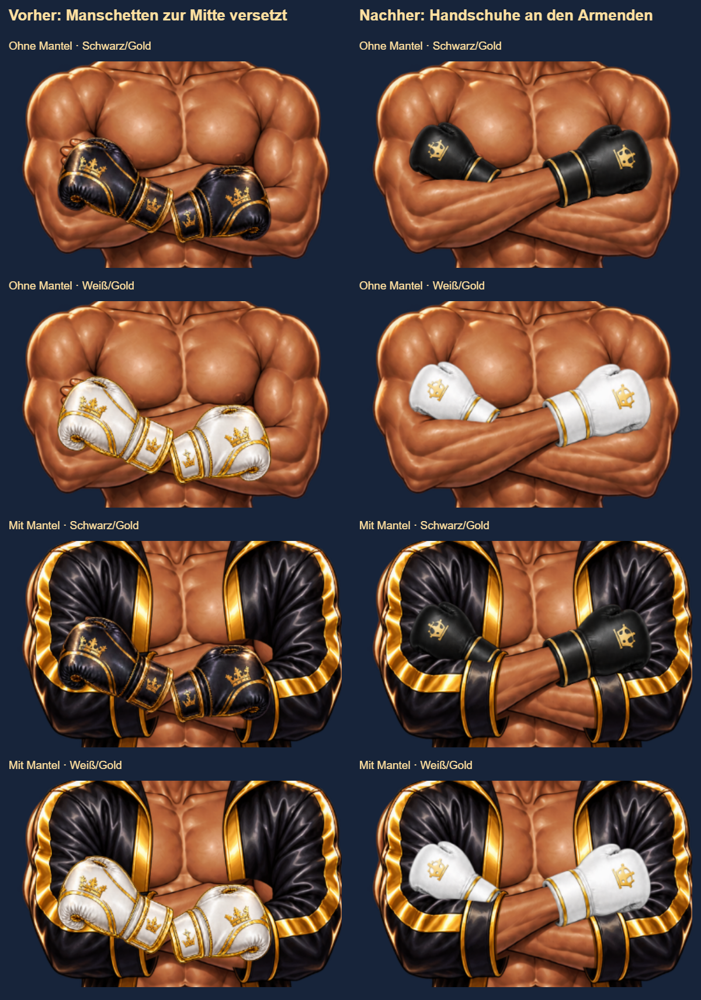

# Modularer Cool-Entwurf – zwölf registrierte PNGs

Stand: 30. Oktober 2026. Dieser Entwurf ergänzt die acht unveränderten Originalmasken. Er ist ausschließlich unter `mein-boxer.html?art=modular` erreichbar. Beide Manifeste behalten `approved:false` und `enabled:false`; PR #79 bleibt Draft.

## Lieferumfang

Alle zwölf Dateien unter `assets/boxer-artpacks/v1/modular-cool/` besitzen dieselbe transparente Leinwand von 768 × 1216 Pixeln:

- `body.png`: neue V4-Körperbasis, kahler Kopf, vollständiger Körper mit gekreuzten Armen, Unterhose und nackten Füßen.
- `eyes.png`, `feet.png`: braune Augen und schwarze/goldene Stiefel.
- `hair-afro.png`, `hair-short.png`: vorhandene Afrozeichnung und neu gezeichneter Kurzhaarschnitt.
- `bottom-black.png`, `bottom-red.png`: vollständige TAKEOVER-Shorts inklusive seitlicher Stoffflächen.
- `hands-blackgold.png`, `hands-white.png`: zwei Handschuhvarianten für die gekreuzten Arme.
- `coatback.png`, `coatfront.png`: hinterer Mantel und Vorderseite mit Ärmeln.
- `top-tank.png`: schwarzes Tanktop mit transparentem Ausschnitt für die davorliegenden Arme.

Elf Dateien stammen aus neuen Imagegen-Zeichnungen einschließlich der bereits vorhandenen V4-Studie. Die Afrozeichnung stammt unverändert aus `cool/hair.png`. Für die Registrierung wurden die vollständigen Zeichnungen ausschließlich proportional skaliert und verschoben. Es gibt keine Laufzeitverzerrung, kein CSS-Recoloring und keine Rekonstruktion verdeckter Haut aus den alten Masken. Die Farbvarianten wurden als eigene Bilder erzeugt. `registration.json` dokumentiert Quelle, Skalierung und Versatz; `inventory.json` dokumentiert die finalen Hashes und Größen.

## Unterstützte Kombinationen

32 Kombinationen: Mantel aus/Samurai × Oberteil aus/Tank × Shorts schwarz/rot × Afro/Kurzhaar × Handschuhe schwarzgold/weiß. Feste Grundlage: Cool-Pose, Haut 6, braune Augen, schwarze Haare, schwarze Boots, kein Headwear, keine Aura oder Augeneffekte. Nicht unterstützte Auswahlen verwenden den vollständigen SVG-Renderer.

Die Ebenenreihenfolge lautet Mantel hinten → Körper → Shorts → Stiefel → Tank → Augen → Haare → Mantel vorne → Handschuhe. Beim Wechsel lädt der Renderer alle benötigten Bilder, bevor er das gesamte Outfit einblendet. Während des Ladens oder bei einem fehlenden Bild erscheint die vollständige SVG-Figur. Der Hinweis „Entwurf – nicht freigegeben“ bleibt sichtbar. Die Vorschau verändert weder gespeicherte Konfigurationen noch Besitz oder Kontostand.

## Prüfung und Grenzen

Lokal bestanden: Chromium 32/32 und WebKit 32/32, jeweils zusätzlich Desktop 1440×900, atomarer Ladewechsel und fehlende PNG-Datei. Die vier vergrößerten Outfitbögen (alle 32 Varianten) und Browseransichten wurden visuell gesichtet. Der Draft-Hinweis verdeckt Haare/Augen nicht. Die Prüfung fand und behob einen Desktop-Container mit null Breite sowie einen mobilen Höhensprung durch den langen Verwerfen-Button. Die neun Mein-Boxer-Vertrags-/Preloadprüfungen und die bestehende responsive Editor-Matrix sind erfolgreich. Nach der unten dokumentierten Handschuhkorrektur: zwölf PNGs zusammen 2.095.122 Bytes, größte Datei 530.922 Bytes; konservatives größtes Outfit 1.793.563 Bytes.

`node tests/boxer-modular-art-browser.cjs` prüft alle 32 Kombinationen mit tatsächlichen Repository-PNGs in Chromium und WebKit: Layerauswahl, gemeinsame Leinwand, mobile Bühnenstabilität, fehlenden Seitenüberlauf, Draftkennzeichnung, unveränderten Standardmodus, atomaren Wechsel und 404-Fallback. `SHOTS` speichert die Browseransichten für die visuelle Prüfung. Die beiden modularen Vertragstests prüfen außerdem Gating, Konfigurationsgrenzen, Request-Deduplizierung und Fehlerzustände.

Der Satz ist ein funktionsfähiger, begrenzter Artwork-Entwurf, keine Freigabe der gesamten Garderobe. Die neue Anatomie und das Gesicht unterscheiden sich von der Originalrekonstruktion; die Datei `hair-short.png` zeigt einen kurzen strukturierten Schnitt. Andere Hauttöne, Posen, Frisuren, Kleidungsformen und Ausrüstungskacheln sind damit nicht neu gezeichnet. Ein physisches iPhone wurde nicht getestet. Die persönliche künstlerische Abnahme bleibt offen; kein Merge, Deployment oder Aktivieren der Grafikflags ist Bestandteil dieses Schritts.

## Anatomische Handschuhkorrektur nach `a318638` – 31. Oktober 2026

Die damaligen grünen Ladetests waren keine anatomische Abnahme. Die Bilddiagnose zeigte beide Manschetten zu weit innen und unten: ungefähr (351,407) und (393,419), statt an den auf der unveränderten Körperbasis markierten Handgelenken um (310,374), hinterer Arm, und (420,386), vorderer Arm. Die alten Handschuhe verdeckten den langen vorderen Unterarm; links ragten zugleich nackte Finger heraus. Die gemeinsam als Produktpaar gezeichnete Form passte nicht zur Kreuzarmhaltung. Eine globale CSS-Verschiebung konnte diese interne Anordnung nicht korrigieren.

Die beiden Handschuhe wurden anhand der Körperbasis neu gezeichnet. Der Handschuh links im Bild gehört zum hinteren Arm; seine Unterkante ist entsprechend der Verdeckung durch den vorderen Unterarm ausgespart. Der Handschuh rechts im Bild setzt mit seiner Manschette an dessen Handgelenk an und zeigt nach außen. Die weiße Variante wurde aus derselben Zeichnung abgeleitet. Beide Exporte nutzen **denselben** proportionalen Faktor `0.4` und Versatz `(173,117)`, ohne Verzerrung oder CSS-Sonderbehandlung. Quellenhashes und Anker stehen in `registration.json`.

Körperbasis, Tanktop, Mantel und Originalmasken blieben unverändert. Die vorhandene Ebenenreihenfolge reicht aus; zusätzliche Vorderarmdateien oder Rendereränderungen waren nicht notwendig. Die freiliegenden Unterarme, Manschetten, Fingerabdeckung und Überlagerungen wurden mit beiden Farben, Mantel an/aus und Tank an/aus im vergrößerten Ausschnitt geprüft.

### Gezielte Regression

- Chromium und WebKit: je 32/32 Outfitkombinationen plus **16 Handschuhansichten** (2 Farben × 2 Mantelzustände × 2 Tankzustände × Mobil 390×844 / Desktop 1440×900).
- Pixelprüfungen auf der echten 768×1216-Leinwand: beide Handgelenkanker und sieben Haut-/Fingerproben abgedeckt; vier innere Unterarmproben frei von Handschuhpixeln. Die zusammengesetzten Outfits erhalten dort exakt die Körperpixel, auch mit Tank und Mantel.
- Größen-/Lagefenster für beide Hände verhindern die frühere Zentrierung auf den Unterarmen. Die zwei Farbvarianten haben **97,30 %** binäre Alpha-Übereinstimmung (IoU), unter **1 px** Schwerpunktabweichung pro Handschuh und höchstens **1 px** Unterschied an den Begrenzungen. Sie sind anatomisch gleich registriert, nicht pixelidentisch gezeichnet. Die Tests erlauben höchstens 2 px Kontur- und 1,5 px Schwerpunktabweichung.
- Der CI-Browserjob veröffentlicht Ganzansichten, vergrößerte Armausschnitte und `*-glove-pixels.json`. Pixeltests sichern diese konkreten Fehlermerkmale ab; natürliche Anatomie, Materialwirkung und Handzuordnung erfordern weiterhin die dokumentierte Sichtprüfung.
- Lokale Negativkontrolle mit den beiden unveränderten alten PNGs aus `a318638`: Beide scheitern an den neuen Prüfungen für freie Unterarme und abgedeckte nackte Hände. Damit ist belegt, dass die Regression den ursprünglichen Fehler erkennt.

**Ergebnis:** technisch korrekt registriert und nach der durchgeführten Sichtprüfung für diese Cool-Kombinationen ausreichend korrigiert. Keine schwebenden Fäuste, freiliegenden zusätzlichen Finger oder auf den Bauch verschobenen Manschetten mehr in den geprüften Ansichten. Geringe zeichnerische Konturunterschiede zwischen den Farben bleiben; die persönliche künstlerische Freigabe des Auftraggebers und alle Aktivierungsflags bleiben offen beziehungsweise ausgeschaltet.
