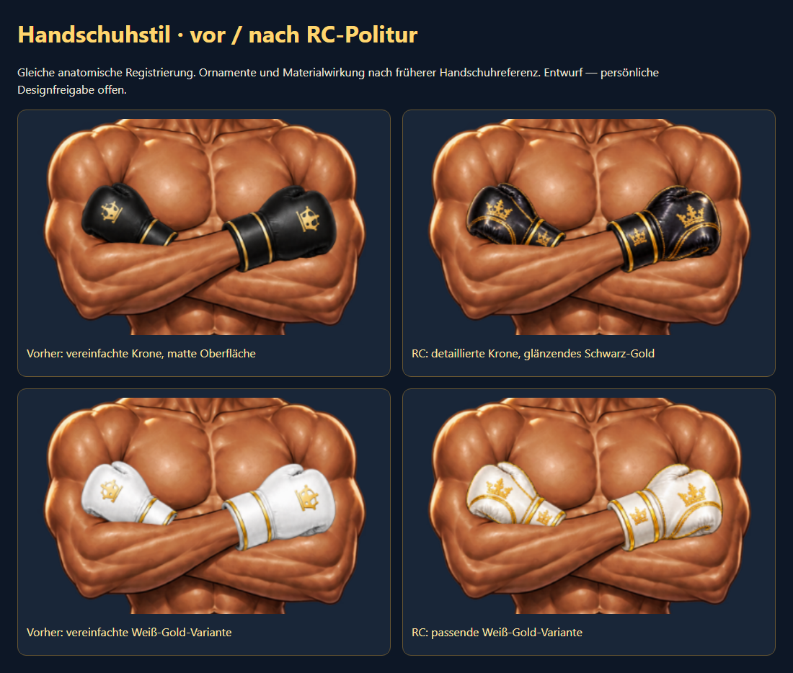

# PR #79 — Final Polish / Release Candidate

Stand: 31.10.2026. Basis: `68660d59611c8b29fc9a530eec5f86267fe476a2`; beim Start waren GitHub-Head und lokaler Branch identisch, keine fremden Zwischenänderungen. PR bleibt Draft. Kein Merge, Deployment, Force-Push oder Eingriff in produktive Daten.

## Ausgeführte Änderungen

1. Ausschließlich `hands-blackgold.png` und `hands-white.png` gezielt überarbeitet: glänzendes Leder, detaillierte Goldkronen auf Hand und Manschette sowie feinere Goldnähte nach dem zugänglichen früheren Handschuhdesign. Körper, Mantel, Tank und die acht Originalmasken bleiben unverändert. Keine neue Pose und kein Rendererumbau.
2. Anatomische Registrierung beibehalten: gleicher proportionaler Faktor 0,4 und Versatz (173,117), unveränderte Körper-Handgelenkanker. Die hintere Handschuhunterkante bleibt für den vorderen Unterarm ausgespart. Quellenmaße, Quellenhashes und Dateiinventar aktualisiert.
3. Bestehende Transaktionssuite um WebKit-Auswahl ergänzt und in beiden Browsern in der CI-Matrix verankert. Keine Shop-/Inventarlogik geändert.
4. Nachgewiesenen Erstladefehler korrigiert: unabhängig asynchron dekodierte PNG-Ebenen konnten kurzfristig Haare/Handschuhe auslassen. Bereits vorgeladene Ebenen verwenden nun synchrones Decoding für die gemeinsame Darstellung. Neue Pixelregression vergleicht den ersten sichtbaren Bildsatz mit dem vollständig dekodierten Bildsatz in beiden Browsern.
5. Neues Abnahmepaket mit echten Browserbildern, sechs Posen, vier repräsentativen Outfits, allen 32 Varianten als Übersicht, normalem SVG-Editor und Vorher-/Nachher-Vergleich erstellt und visuell gesichtet.

## Referenzen und künstlerische Grenzen

Die ursprüngliche Handschuhzeichnung ist in der Git-Historie und im früheren Vorher-/Nachher-Bogen zugänglich. Sie zeigt glänzendes schwarzes Leder, komplexere Kronen und zusätzliche Goldnähte. Ihre damalige falsche Platzierung wurde ausdrücklich **nicht** zurückübernommen. Die neue Materialwirkung nähert sich dieser Referenz an; eine pixelidentische Form- oder Designrekonstruktion wird nicht behauptet. Die erste weiße Farbvariante scheiterte an der unveränderten Konturprüfung und wurde verworfen. Die nachgebesserte Variante besteht dieselbe Prüfung ohne gelockerte Grenzwerte.

Die separat dokumentierte 1536×1024-Gesamtvorlage fehlt weiterhin als Originaldatei. Die zugängliche Originalrekonstruktion trägt Bandagen; sie ist keine genaue Handschuhreferenz. Gesicht und Muskulatur des modularen Körpers weichen weiterhin von dieser Originalrekonstruktion ab. Ausrüstungskacheln bleiben SVG; fünf Posen und nicht unterstützte Cool-Konfigurationen bleiben vollständig SVG. Keine dieser Grenzen wurde als behoben oder persönlich freigegeben ausgegeben.

Verwendet wurde der eingebaute Imagegen-Modus. Hauptprompt: „Restore original glossy black leather, fine ornate gold seam piping, detailed embroidered royal crowns on knuckles and cuffs. Keep exact glove placement, dimensions, orientations, silhouette and transparent boundary, including the occluded rear lower edge. Do not copy the incorrect inward placement. Change only material surface and gold detailing; no body, skin or background.“ Weiß: „Precise recolor only; black leather to ivory white, preserve gold embroidery, canvas coordinates, silhouettes, cuff openings and transparency.“ Rohdateien und vollständige Prompts liegen im lokalen Abnahmepaket; nur registrierte PNGs werden vom Editor verwendet.

## Tests und Sichtprüfung

- Chromium und WebKit: je **32/32 echte PNG-Outfits + 16 Handschuhansichten**. Handgelenke/Fingerabdeckung, freie Unterarme, Bildgrößen, Farbwechsel, atomare Darstellung, absichtlich fehlende Datei und fehlende Schreibaufrufe bestanden. Alpha-IoU **97,18 %**, unveränderte Mindestgrenze 96 %; Schwerpunkt-/Konturgrenzen bestanden.
- Beide Engines: sechs Posen, unabhängige Profil-/Kartenpose, Save während weiterer Änderung, Verwerfen/Reset/Reload und verspätete Bildantwort bestanden. Andere Posen erhalten niemals Cool-PNGs.
- Beide Engines: Einzel-/Bundlekauf, Doppelbestätigung, optionaler Leistungsfehler, fehlgeschlagene/leere/deaktivierte Inventarantwort und Speichern gekaufter Ausstattung bestanden. Ausschließlich isolierte lokale RPC-Mocks; keine echten Coins ausgegeben.
- Beide Engines: Viewports **375×812, 390×844, 430×932, 768×1024, 1440×900**, Resize, Scroll und Tastatur; zusätzliche Studio-Breiten und Original-PNG-Ansichten bestanden. Vollständige Holo-Integration lokal Chromium bestanden.
- Relevante Staging-Verträge, Grafikvalidatoren, Hashprüfungen, CSS-/JS-Prüfungen und isolierter Pages-Dateiumfang lokal bestanden. ZIP-Import benötigt das unter Windows fehlende `zip` und bleibt verbindlich im Linux-CI. Die CI des aktuellen Heads ist vor Abschluss maßgeblich; Links werden in der PR-Beschreibung und im ausgelieferten Bericht bestätigt.
- Aktuelles GitHub-CI-Artefakt der Basis `68660d5`: `mein-boxer-rendered-screens`, Run `41145672359`, SHA-256 `f968d3cdd026f0cf57b4c9fc3721a934a469369a8c1bfc0ac3cb5dfa4a20ffc2`. Originalrekonstruktion gegen lokale neue Browseransichten gesichtet.
- Visuell geprüft: Übersicht der 32 Outfits, vergrößerte Handschuhe mit/ohne Mantel/Tank, Mobil-/Desktopansichten, sechs Posen und normaler SVG-Editor. Keine neu sichtbaren offenen Handflächen, schwebenden Handschuhe, doppelten Arme oder abgeschnittenen Inhalte in diesen Ansichten. Kein persönliches künstlerisches Urteil vorweggenommen.

Screenshots zeigen lokale Testkonten mit begrenztem Inventar. Interne Frisurnamen in einzelnen Testbildern stammen aus dem Mock-Katalog, nicht aus einer geänderten Produktionsbeschriftung. Die Galerie lädt ausschließlich beigefügte Dateien und funktioniert nach Entpacken offline.

## Performance und gesamter Diff zu main

Keine neue Runtime-Abhängigkeit oder zusätzliche Editor-Neurenderlogik; lediglich das Decoding der vorgeladenen Bildebenen wurde für die gemeinsame Darstellung angepasst. Maximal drei parallele Preloads, gemeinsame laufende Requests und URL-Statuscache bleiben unverändert. Async-Bildabschluss aktualisiert nur die Figur, nicht Fokus/Scrollposition der Ausrüstung. Vorhandene Performance-/Race-Tests bestehen; kein nachgewiesener Restfehler rechtfertigt einen Umbau. Dekodierte Browser-/GPU-Caches sind nicht direkt kontrolliert; keine physische Speicherprofilierung behauptet.

Die zwölf PNGs umfassen jetzt **2.113.320 Bytes**. Leinwand bleibt 768×1216: reine RGBA-Abschätzung 3,56 MiB pro Bild bzw. 42,75 MiB für alle zwölf, ohne Browser-/GPU-Overhead. Normaler Editor: null Entwurfsbildrequests.

Gesamter PR-Diff zu `main` geprüft: keine SQL-/Migrations-, RLS-, Benutzerrechte- oder Shopkatalogänderungen. Persistierte Ausstattungs-/Pose-Schlüssel bleiben erhalten. Bestehende RPC-IDs und Kaufwerte unverändert; bereits enthaltene Fehlerbehandlung im Editor bleibt bestehen. Keine zwischenzeitlichen main-Konflikte beim Ausgangsabgleich; vor späterem Merge erneut prüfen.

Realer Pages-Dateizusammenbau isoliert ausgeführt: **66 Rootdateien, 14 Avatar-Dateien, 0 Premium-PNGs**. Tools, Tests, Docs, Quellreferenzen und die ausgeschlossenen Previewseiten werden nicht mitkopiert. Relevante relative Editorpfade werden durch die Browserprüfung des zusammengesetzten Builds aufgelöst. Die absichtlich fehlenden Draft-PNGs unter `?art=modular` ergeben eine vollständige SVG-Figur. Beide Manifeste bleiben `approved:false`, `enabled:false`. Kein Newsabruf, Pages-Upload oder Deployment als Teil dieses Auftrags.

## Entscheidungsmatrix

| | Release A: UI mit SVG | Release B: Premium-Art |
| --- | --- | --- |
| Technisch | Für manuelle Abnahme vorbereitet; aktuelle CI muss grün sein | Begrenzter Cool-Entwurf technisch geprüft; noch kein freigegebener Produktionspfad |
| Design freigegeben | Persönliche UI-Abnahme offen | Persönliche Grafikabnahme ausdrücklich offen |
| Produktiv freigegeben | Nein | Nein |
| Vorteil | Vollständiger bestehender SVG-Ausstattungsumfang, keine Entwurfs-PNGs oder zusätzliche Texturlast | Hochwertigere gemalte Cool-Figur und 32 modular wechselbare Outfits |
| Nachteil | Einfachere SVG-Optik gegenüber der Anime-Referenz | Begrenzte Varianten und sichtbarer Stilwechsel bei Fallback; weitere Art-Arbeit nötig |
| Nächster Schritt | Physische Geräte-/Accessibility-Abnahme, ausdrückliche Merge-/Release-Freigabe | Handschuhstil/Gesicht/Anatomie abnehmen, dann separat Aktivierungs- und Auslieferungskonzept prüfen |

**Empfehlung: Release A zuerst separat freigeben.** Beide Wege bleiben getrennt. Für B reicht es nicht, blind beide Draft-Flags einzuschalten: Der jetzige Publisher verwendet das freigegebene Standardmanifest; das modulare Manifest ist ein eigener Vorschaupfad. Ein späterer Premium-Meilenstein muss Standardauswahl, erlaubte Pose-/Outfitgrenzen, publizierte Dateien, Fallback und Rückschaltung zusammen testen. In diesem PR werden dafür keine Flags oder Daten geändert.

## Noch NICHT durchgeführte manuelle Tests

Auf einem explizit bereitgestellten Teststand des PR-Branches mit Testkonto durchführen, **nicht** durch einen eigenmächtigen Produktionsrelease ermöglichen. Käufe ausschließlich mit Testdaten/Mock-Backend.

1. **iPhone/Safari, zusätzlich installierte Web-App falls genutzt:** Hoch-/Querformat wechseln; Browserleiste ein-/ausblenden; jede Ausrüstungskategorie bis unten scrollen. Figur und Save/Verwerfen müssen sichtbar bleiben; kein Scroll-Fangen, kein Überdecken durch Safe Area oder Tastatur. Unterbrechung/Hintergrundwechsel und Rückkehr prüfen.
2. **Android/Chrome:** dieselben Schritte; schnelle zehnfache Outfit-/Posewechsel, langsame Verbindung und Offline/Online simulieren. Vollständige Figur oder vollständiger SVG-Fallback, keine halben Outfits; App reagiert weiter. Speicher-/Wärmeverhalten am realen Gerät beobachten.
3. **Speichern/Reset:** beide Pose-Felder unterschiedlich wählen, andere Ausrüstung ändern, speichern und neu laden. Dann ungespeichert ändern/verwerfen. Bei verzögertem Speichern weiter ändern: neue Auswahl darf nicht verloren gehen. Profil-/Kartenpose müssen getrennt bleiben.
4. **Testkäufe:** Einzelartikel/Bundle bestätigen, abbrechen, doppelt tippen; Fehlerantwort und Inventarnachladen prüfen. Nur eine Buchung, korrekter Bestand und Coins; gekaufter Artikel anschließend auswähl-/speicherbar.
5. **VoiceOver oder NVDA:** nur per Tastatur bzw. Screenreader durch Kategorien, Optionen, Shopbestätigung und Save/Verwerfen navigieren. Beschriftungen, ausgewählte Zustände und Rückmeldung prüfen; Fokus darf nach Outfitwechsel nicht verschwinden oder gefangen bleiben. Bei 200 % Zoom wesentliche Aktionen erreichbar halten.
6. **Persönliche Grafikabnahme:** Vorher-/Nachher-Board und reale Outfits mit beiden Farben, Mantel und Tank vergleichen. Krone, Goldnähte, Lederwirkung, Handgröße, hintere Verdeckung sowie Gesicht/Körper gesondert bestätigen oder konkret beanstanden.

## Restprobleme und Abschlussgrenze

Keine verbleibenden P0-/P1- oder nachgewiesenen relevanten P2-Fehler in den geprüften Abläufen. Offene Punkte sind persönliche Grafik-/UI-Abnahme, physische Geräte-/Assistenztests und spätere explizite Produktivfreigabe. Weitere technische Änderungen ohne neuen Befund werden beendet. Technisch bereit für manuelle Abnahme bedeutet weder Designfreigabe noch Produktivfreigabe.
