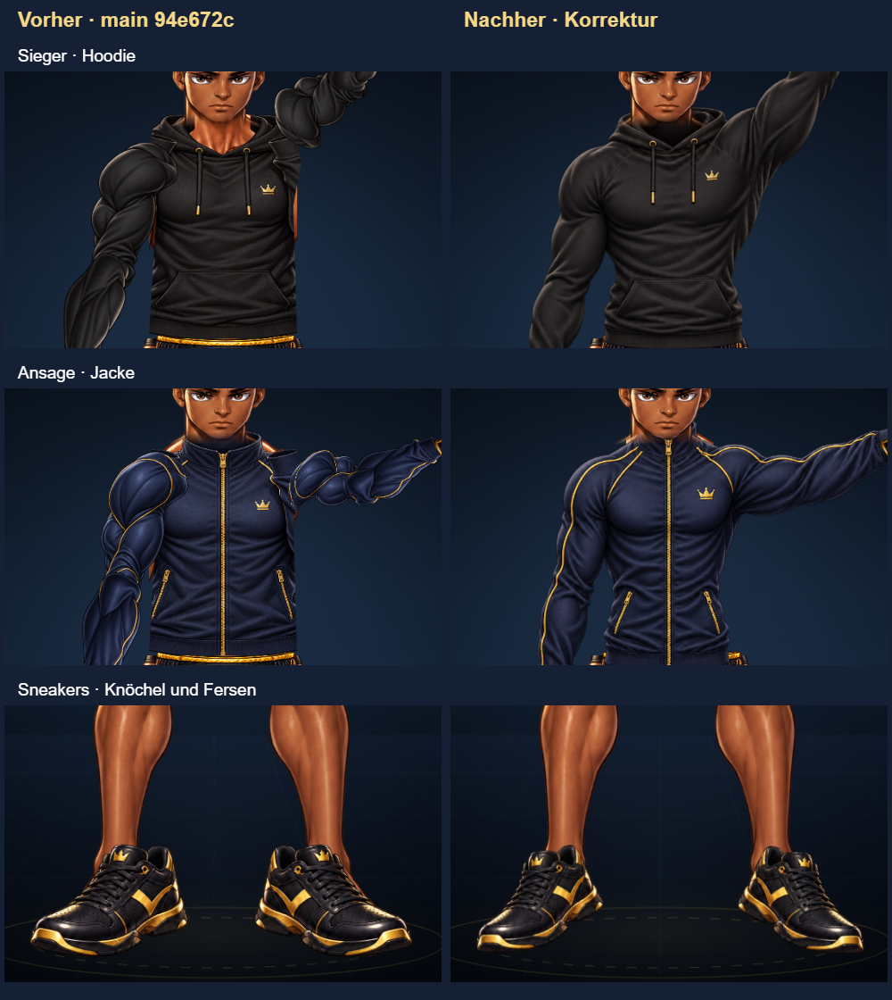

# Schulter- und Schuhkorrektur für Sieger und Ansage

Ausgangsstand: `94e672c41b6b962173f0d39b89776696f9cb2b98`. Die Korrektur liegt auf einem eigenen Review-Branch. Release-Schalter, Datenbank, Besitz und Preise werden nicht geändert.

Die bisherigen Ärmel wurden aus einzeln gedrehten Guard-Segmenten zusammengesetzt. Bei Sieger und Ansage entstanden kleine, abgetrennte Schulterkappen. Shirt, Hoodie, Trainingsjacke und die vier Mantel-Fronten haben für diese beiden Posen nun durchgehende Schulter-/Ärmelgrafiken. Die Kontur folgt der vorhandenen Körperbasis. Die übrigen vier Posen behalten ihre bisherigen Oberteile.

Die Registrierung steht in `completion/shirt.json` und `completion/pose-bodies.json`, nicht in CSS. Geschlossene lange Oberteile zeigen nur die ursprüngliche Hals- und Handgelenkhaut unter der Kleidung; Körper-PNGs und Handschuhanker bleiben unverändert. Mantel-Front und Mantel-Back bleiben getrennt von den Unterteilen. Bei Basic, Neon und Drache richtet eine affine Transformation Kragen und beide Ärmelbündchen an den bestehenden Gelenkankern aus. Die darunter anschließende Rocklänge wird am gleichen Schnitt registriert. Beide Ausschnitte beziehen sich auf dieselbe vollständige Front-PNG.

Die Sneakers hatten links 45 und rechts 54 Bildpunkte Abstand zwischen Schuhöffnung und Körperknöchel. Die vorhandene PNG wird nun in zwei Teile aufgeteilt, gleichmäßig mit Faktor 0,84 skaliert und um die jeweilige Knöchelposition um 12 Grad gedreht. Alle bemalten Quellpixel bleiben genau einmal enthalten. Es gibt keine neue Schuhgrafik und keine abdeckende Körpermaske. Stiefel bleiben unverändert.

Figur und Auswahlkachel verwenden denselben Resolver, dieselben Dateien und Materialschlüssel. Neue Item-Bounds berücksichtigen die registrierte Lage. Es gibt keine separaten Vorschaubilder und keine Ganzkörper-Screenshots in den Item-Kacheln.

## Nachweise

Die folgenden Prüfungen liefen auf dem finalen Arbeitsstand in Chromium und WebKit; die Zahlen gelten jeweils pro Browser:

- 54 Shirt-Kacheln pixelgenau; 27 unveränderte Ganzkörperkombinationen für Cool/Guard/Jab; 36 unveränderte Handschuh-/Unterteilpaare gegenüber dem gepinnten Vergleichsstand.
- 42 Hoodie-/Jacken-/Mantelkacheln pixelgenau, einschließlich Kapuze oben/unten; zwölf Outfitwechsel im echten Editor bei 390 bzw. 412 Pixeln Breite.
- Alle zwölf neuen äußeren Kleidungsdateien einzeln mit HTTP 404 geprüft: ganze Figur und betroffenes Item wechseln auf SVG. Zusätzliche Shirt-Ausfälle sind im Shirt-Test abgedeckt.
- 432 Schuh-/Unterteil-/Mantelkombinationen, 36 exakte Schuhkacheln. Knöchelabstand 0/0 Pixel. Keine unbedeckten Fersen-/Zehenpixel im geprüften Bereich unterhalb y=1100.
- 120 gerenderte Mantel-/Oberteilkombinationen über vier Retarget-Posen; isolierte Unterteile mit und ohne Mantel pixelidentisch.
- 1.764 einzelne Katalog-/Materialvarianten und deren Quellhashes. Dies ist keine visuelle Freigabe sämtlicher möglicher Farbkombinationen.

100-%- und 200-%-Ausschnitte liegen unter `output/shirt-qa/` und `output/foot-qa/`; vollständige Outfit-Kontaktbögen unter `output/fit-qa/accepted-outfits/`. Die CI lädt die neuen Browsernachweise als Artefakte hoch. Mobile Prüfungen sind Browser-Viewporttests, keine Tests auf physischen iPhones oder Android-Geräten. Die Testkonten sind lokale Fixtures; es erfolgen keine Käufe oder Speicheraufrufe.

## Kosten und Herkunft

14 zusätzliche Kleidungs-PNGs belegen zusammen 10,22 MiB (10.719.715 Bytes). Sie werden nur für ausgewählte Outfits der beiden betroffenen Posen geladen. Cache-Grenzen bleiben unverändert. Beide Sneakers samt Kachel benötigen beim ersten Rendern zusammen eine Quellanfrage. Beim Durchlauf aller 432 Kombinationen wurde dieselbe Datei nach Cache-Verdrängung insgesamt viermal angefordert; es gibt keine zusätzliche Datei pro Schuh.

Die Kleidungsbilder wurden mit dem eingebauten `image_gen.imagegen` erzeugt. Originalbytes, Dateipfade, SHA-256, verwendete Prompts und Registrierung sind in [shoulder-foot-provenance.json](shoulder-foot-provenance.json) dokumentiert. Ausgewählte Dateien liegen in `tools/premium-v2/completion/assets/`. Quellgrafiken für Körper, Unterteile, Handschuhe, Mantelrückseiten und Schuhe werden weiterverwendet.
